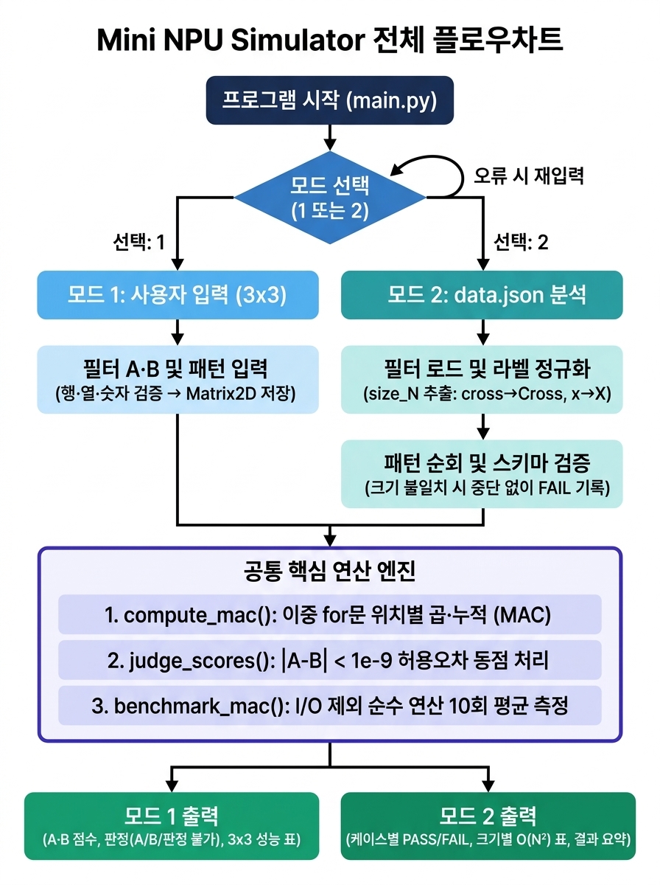

# Mini NPU Simulator (MAC 연산 기반 패턴 판별 계산기)

## 0. 프로젝트 청사진
---

---

## 1. 프로젝트 개요
AI 연산의 핵심인 **MAC(Multiply-Accumulate)** 연산을 외부 라이브러리 없이 순수 Python 반복문으로 직접 구현하여, 2차원 숫자 배열(패턴)과 필터 간의 유사도를 계산하고 크기 증가에 따른 연산 시간과 시간 복잡도($O(N^2)$)를 검증하는 콘솔 시뮬레이터입니다.

- **개발 환경**: Python 3.8 이상 (외부 라이브러리 미사용, 표준 라이브러리 `json`, `math`, `pathlib`, `re`, `time`만 사용)
- **원격 저장소**: https://github.com/poxaci447/E1-3

## 2. 실행 방법

### 2-1. 파일 위치 확인
프로젝트 루트 디렉터리에 `main.py`와 제공된 `data.json`이 함께 위치해야 합니다.

```text
repo/
├── main.py        # Mini NPU 시뮬레이터 실행 파일
├── data.json      # 5x5, 13x13, 25x25 필터 및 패턴 테스트 데이터
├── .gitignore     # Git 추적 제외 설정
└── README.md      # 실행 방법, 구현 요약 및 결과 리포트
```

### 2-2. 프로그램 실행 및 모드 선택
```bash
python main.py
```

실행 후 콘솔 안내에 따라 모드를 선택합니다.
- **`1` (사용자 입력, 3x3)**: 3x3 필터 A, 필터 B, 입력 패턴을 한 줄씩 공백으로 구분해 입력하면 두 필터의 MAC 점수, 10회 반복 평균 연산 시간(ms), 판정 결과(`A` / `B` / `판정 불가`)와 3x3 성능 표를 출력합니다.
  - 행·열 개수가 3개가 아니거나 숫자로 변환할 수 없는 입력이 들어오면 안내 메시지를 출력하고 해당 행을 재입력받습니다.
- **`2` (data.json 분석)**: 프로젝트 루트의 `data.json`에서 `size_5`, `size_13`, `size_25` 필터와 전체 패턴을 로드·검증하여 케이스별 판정(`Cross` / `X` / `UNDECIDED`), `PASS`/`FAIL` 여부, 크기별(3x3 포함) 평균 연산 시간 표 및 결과 요약을 출력합니다.

## 3. 구현 요약

### 3-1. 데이터 구조 (`Matrix2D`) 및 주요 함수
- **`Matrix2D`**: $N \times N$ 2차원 정사각 행렬을 캡슐화하며 `get(row, col)`, `set(row, col, value)`로 특정 위치의 원소에 접근합니다. `from_raw()` 메서드로 JSON 배열의 행·열 크기 일치 여부와 유한한 숫자 타입을 검증합니다.
- **스키마/크기 불일치 방어**: `data.json` 분석 시 패턴 키(`size_{N}_{idx}`)에서 크기 $N$을 추출해 대응하는 `size_N` 필터를 선택하고, 행렬 크기나 스키마가 어긋난 경우 프로그램을 중단하지 않고 해당 케이스만 `FAIL`과 원인 메시지로 기록합니다.

### 3-2. MAC 연산 구현 (`compute_mac`)
- NumPy 같은 벡터화 라이브러리를 사용하지 않고 이중 `for` 반복문으로 입력 패턴과 필터의 동일 위치 `(r, c)` 원소를 곱해 누적 합산합니다.
- 입력 패턴과 필터의 모양이 일치할수록 값이 겹치는 위치가 많아져 MAC 점수가 높아지고, 모양이 다를수록 점수가 낮아지는 원리로 패턴 유사도를 판별합니다.
- 실제 AI 추론에서는 수백$\times$수백 크기의 필터 수천 개에 대해 수억 회 이상의 MAC 연산이 필요하므로, 직렬 처리 중심의 CPU 대신 대량의 MAC을 병렬 처리하는 NPU(Neural Processing Unit)가 필수적입니다.

### 3-3. 라벨 정규화 (`normalize_filter_key`, `normalize_expected_label`)
`data.json` 내부에서 필터 키(`"cross"`, `"x"`)와 정답 라벨(`"+"`, `"x"`)의 표기가 서로 다르기 때문에, 프로그램 내부에서는 표준 라벨 **`Cross`** 와 **`X`** 2가지만 사용하도록 정규화합니다.
- **필터 키 정규화**: `"cross"` $\rightarrow$ `"Cross"`, `"x"` $\rightarrow$ `"X"`
- **expected 정규화**: `"+"` $\rightarrow$ `"Cross"`, `"x"` $\rightarrow$ `"X"`
- 모든 콘솔 출력과 `PASS`/`FAIL` 비교는 정규화된 표준 라벨 기준으로 일관되게 수행합니다.

### 3-4. 점수 비교 및 동점 처리 정책 (`judge_scores`)
- 부동소수점 누적 연산에서 발생하는 미세한 오차(예: `0.9000000000000000` vs `0.8999999999999999`)로 인해 수학적 동점이 한쪽으로 잘못 치우쳐 판정되는 문제를 방지하기 위해 허용오차($\epsilon = 10^{-9}$) 기반 비교 정책을 적용했습니다.
- `abs(score_a - score_b) < 1e-9` 조건을 만족하면 동점으로 간주하여 모드 1에서는 `판정 불가`, 모드 2에서는 `UNDECIDED`로 판정합니다.

## 4. 결과 리포트

### 4-1. `data.json` 실행 결과 요약
총 6개의 패턴 케이스 중 **3개 PASS, 3개 FAIL**이 발생했습니다.

| 케이스 ID | Cross 점수 | X 점수 | 판정 | Expected | 결과 | 비고 |
| :--- | :---: | :---: | :---: | :---: | :---: | :--- |
| `size_5_1` | `0.9000000000000000` | `0.8999999999999999` | `UNDECIDED` | `X` | **FAIL** | 동점($\lvert\text{Cross}-\text{X}\rvert < 10^{-9}$) |
| `size_5_2` | `8.9` | `0.1` | `Cross` | `Cross` | **PASS** | 정상 판정 |
| `size_13_1` | `0.3` | `14.700000000000008` | `X` | `X` | **PASS** | 정상 판정 (부동소수점 누적 오차 관측) |
| `size_13_2` | `7.4999999999999973` | `7.5000000000000000` | `UNDECIDED` | `Cross` | **FAIL** | 동점($\lvert\text{Cross}-\text{X}\rvert < 10^{-9}$) |
| `size_25_1` | `4.9000000000000004` | `4.8999999999999986` | `UNDECIDED` | `X` | **FAIL** | 동점($\lvert\text{Cross}-\text{X}\rvert < 10^{-9}$) |
| `size_25_2` | `52.9` | `0.1` | `Cross` | `Cross` | **PASS** | 정상 판정 |

### 4-2. 실패 원인 분석 (데이터/스키마 vs 로직 vs 수치 비교)
실패 케이스 3건(`size_5_1`, `size_13_2`, `size_25_1`)의 원인을 세 영역으로 분리해 진단한 결과는 다음과 같습니다.

1. **데이터/스키마 문제 여부 (해당 없음)**:
   - 모든 필터(`size_5`, `size_13`, `size_25`)와 패턴 6건의 행렬 크기가 정확히 일치했으며, 라벨 정규화(`'+' -> Cross`, `'x' -> X`)도 정상 동작해 `size_5_2`, `size_13_1`, `size_25_2`가 모두 `PASS`했습니다.
2. **MAC 연산 로직 문제 여부 (해당 없음)**:
   - `size_5_2`(8.9 vs 0.1), `size_13_1`(0.3 vs 14.7), `size_25_2`(52.9 vs 0.1)에서 의도된 패턴의 점수가 압도적으로 높게 계산되어 곱셈·누적 구현 자체에는 오류가 없습니다.
3. **수치 비교 및 데이터 특성 원인 (핵심 원인)**:
   - `size_5_1`(약 `0.9`), `size_13_2`(약 `7.5`), `size_25_1`(약 `4.9`)은 입력 패턴에 대해 Cross 필터와 X 필터의 수학적 실제 MAC 점수가 완전히 동일하게 계산되는 **동점(경계) 케이스**입니다.
   - 컴퓨터는 소수(예: `0.1`, `0.3`)를 IEEE 754 이진 부동소수점으로 근사 표현하기 때문에 덧셈이 누적될수록 $10^{-16} \sim 10^{-15}$ 수준의 반올림 오차가 발생합니다. (통과한 `size_13_1`의 X 점수가 `14.7`이 아닌 `14.700000000000008`로 출력된 것도 같은 이유입니다.)
   - 만약 `epsilon` 없이 단순 대소 비교(`score_cross > score_x`)를 수행했다면, 부동소수점 오차의 방향에 따라 `size_5_1`은 `Cross`, `size_13_2`는 `X`, `size_25_1`은 `Cross`로 **세 케이스 모두 `expected`와 정반대 라벨로 오판정**되는 문제가 발생합니다.
   - 본 프로그램은 허용오차($\epsilon = 10^{-9}$) 비교 정책을 적용해 이 미세 오차를 신호가 아닌 노이즈로 걸러내고 `UNDECIDED`로 안전하게 분류했습니다. 결과적으로 모호한 동점 입력을 억지로 특정 클래스로 단정 짓지 않았기 때문에 `expected`와 불일치하여 `FAIL`로 집계되었으며, 이는 수치 안정성 측면에서 올바른 동작입니다.
   - **개선 방향**: 향후 실서비스에서 동점 입력의 판별력을 높이려면 단순 내적(MAC) 외에 필터 가중치 정규화(L2 Norm/코사인 유사도), 중심점 중복 가중치 조정, 또는 노이즈 제거 전처리 등을 적용해 클래스 간 점수 마진을 확보해야 합니다.

### 4-3. 성능 분석 및 시간 복잡도 ($O(N^2)$) 해석
I/O(콘솔 출력, JSON 파일 읽기) 시간을 제외하고 `compute_mac()` 호출 구간만 `time.perf_counter()`로 크기별 10회 반복 측정한 결과는 다음과 같습니다.

| 크기 ($N \times N$) | 평균 시간 (ms) | 연산 횟수 ($N^2$) | 직전 크기 대비 연산 횟수 배율 | 직전 크기 대비 시간 배율 |
| :---: | :---: | :---: | :---: | :---: |
| `3x3` | `0.0043` | `9` | - | - |
| `5x5` | `0.0047` | `25` | `2.78x` | `1.09x` |
| `13x13` | `0.0271` | `169` | `6.76x` | `5.77x` |
| `25x25` | `0.1213` | `625` | `3.70x` | `4.48x` |

- **이론적 근거 ($O(N^2)$)**: $N \times N$ 크기의 입력 패턴과 필터를 비교할 때 `compute_mac`은 행 `0 ~ N-1`과 열 `0 ~ N-1`을 순회하는 이중 반복문을 수행합니다. 각 원소마다 1회의 곱셈과 1회의 누적이 수행되므로 총 연산 횟수는 정확히 $N^2$에 비례하며 시간 복잡도는 $O(N^2)$입니다.
- **측정 결과 해석**:
  - **작은 크기 구간 (`3x3` $\rightarrow$ `5x5`)**: 연산 횟수는 `2.78배` 늘었지만 평균 시간은 `0.0043 ms` $\rightarrow$ `0.0047 ms`(`1.09배`)로 거의 비슷합니다. 이는 $N$이 매우 작을 때는 실제 곱셈·덧셈 시간보다 Python 함수 호출 및 반복문 초기화 같은 고정 오버헤드가 전체 시간의 대부분을 차지하기 때문입니다.
  - **크기 증가 구간 (`5x5` $\rightarrow$ `13x13` $\rightarrow$ `25x25`)**: 고정 오버헤드 비중이 줄어들면서 실행 시간이 $N^2$에 비례해 가파르게 증가합니다. 특히 `5x5`에서 `25x25`로 한 변의 길이 $N$이 **5배** 커졌을 때 연산 횟수는 **$5^2 = 25$배**(`25` $\rightarrow$ `625`) 증가했고, 실측 평균 시간 역시 `0.0047 ms` $\rightarrow$ `0.1213 ms`로 **약 25.81배** 증가해 $O(N^2)$ 시간 복잡도를 실측으로 입증했습니다.
  - 이 결과는 고해상도 이미지(예: $224 \times 224$ 이상)와 다수의 필터를 사용하는 실제 딥러닝 추론에서 순차 반복 연산량이 제곱 단위로 폭증하는 이유와, 이를 병렬 처리하는 NPU·GPU 가속의 필요성을 잘 보여줍니다.